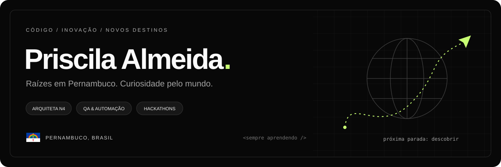

<p align="center">
  
</p>

<h1 align="center">Oi, eu sou a Priscila 👋</h1>

<p align="center">
  <strong>Arquiteta N4 · QA &amp; Qualidade de Software · Curiosa por natureza</strong>
</p>

<p align="center">
  <a href="https://www.linkedin.com/in/priscilatalmeida/">LinkedIn</a>
  &nbsp; · &nbsp;
  <a href="https://github.com/PriscilaDevGirl?tab=repositories">Meus projetos</a>
</p>

---

### Um pouco de mim

🇧🇷 Brasileira, **pernambucana** e mãe de **Letícia e Laura**.

💻 Apaixonada por programação, hoje atuo como **Arquiteta N4 em uma fábrica de software na Vivo**.

🚀 Amo **hackathons e competições de inovação e tecnologia**. Um desafio novo? Já despertou minha curiosidade!

✈️ Amo viajar, conhecer novos lugares e descobrir outras formas de ver o mundo.

📚 Adoro aprender sobre assuntos diversos. Minha curiosidade não cabe em uma única aba do navegador.

### Tecnologia com qualidade

Minha atuação reúne **arquitetura de QA, estratégia de testes e qualidade de software**, com foco em automação e testes de API.

| No meu radar | Ferramentas e conhecimentos |
| :--- | :--- |
| Automação de testes | Selenium · BDD · Cucumber |
| Qualidade de software | Estratégia de testes · Testes de API |
| Formação e certificação | Mestranda em Engenharia de Software na UFPE · ISTQB CTFL |

### Entre códigos e destinos

Gosto de explorar possibilidades — seja em um novo conhecimento, em uma viagem, em um hackathon ou nas soluções que construo com tecnologia.

```text
origem       Pernambuco, Brasil 🇧🇷
meus amores  Letícia & Laura ♡
bagagem      curiosidade e vontade de aprender
próxima rota mais uma descoberta ✈
```

<p align="center">
  <sub>Um pouco de código, um pouco de mundo e muita vontade de aprender.</sub>
</p>
